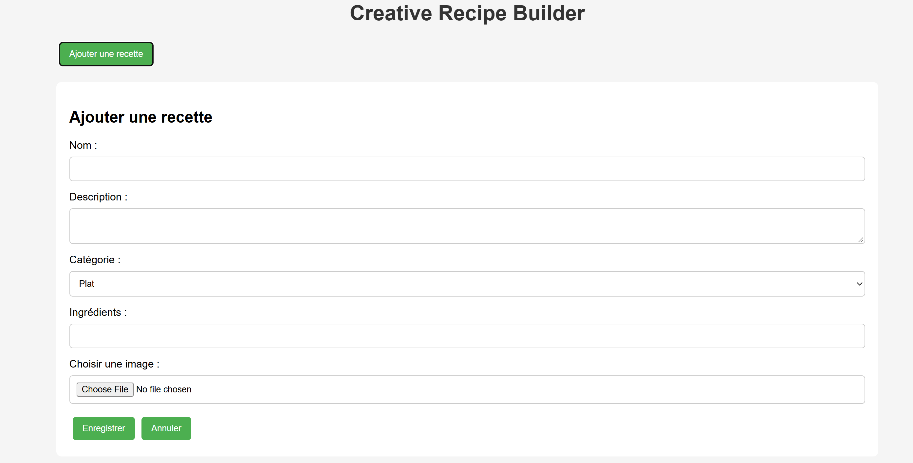
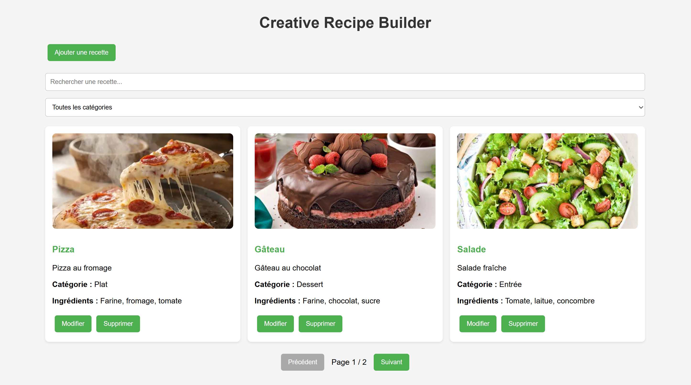

# TP 4 - Creative Recipe Builder

## Description
Ce projet est une application React pour gérer des recettes de cuisine.

On peut ajouter une recette, modifier ses informations et la supprimer. On peut aussi rechercher une recette par son nom et choisir une catégorie.

Chaque recette contient un nom, une description, une catégorie, des ingrédients et une image.

## Technologies utilisées
- React
- JavaScript (JSX)
- CSS

## Résultat

